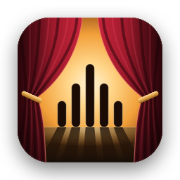
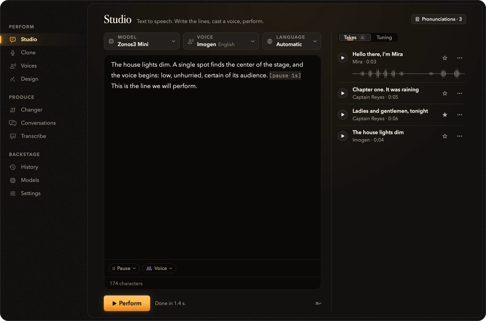
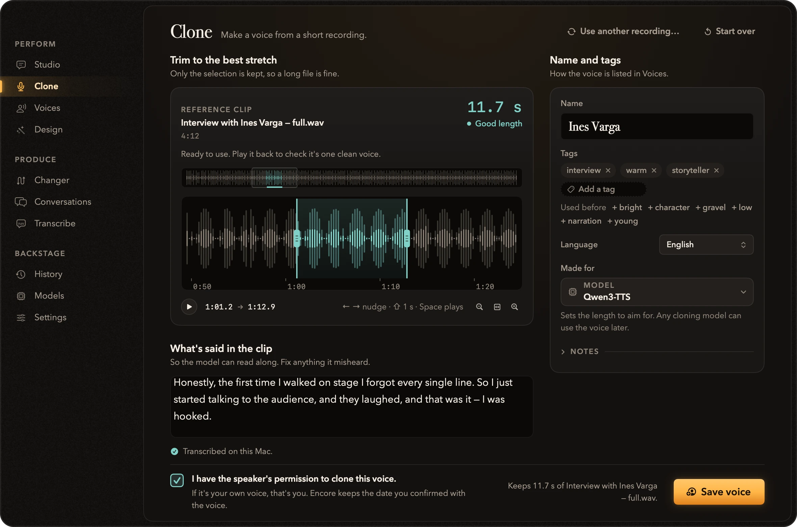
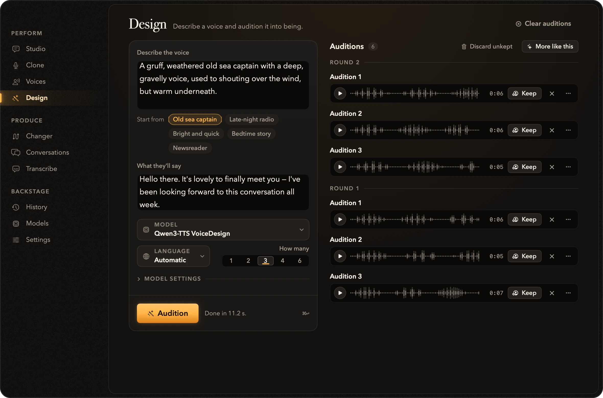
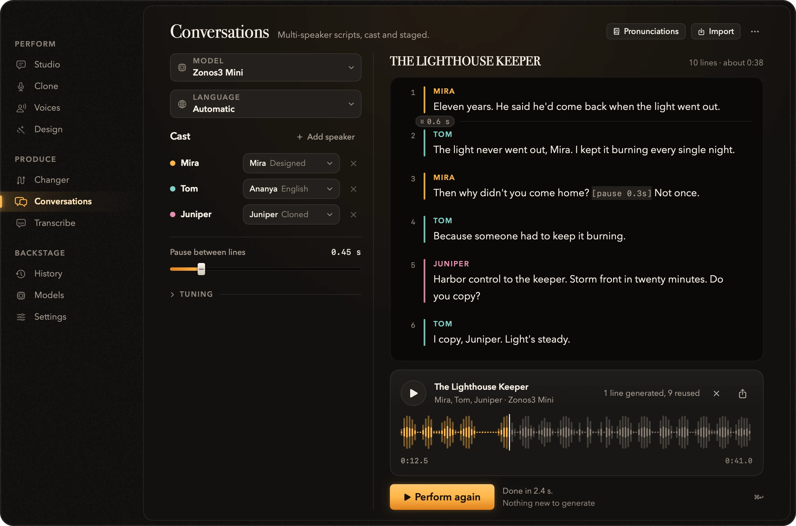
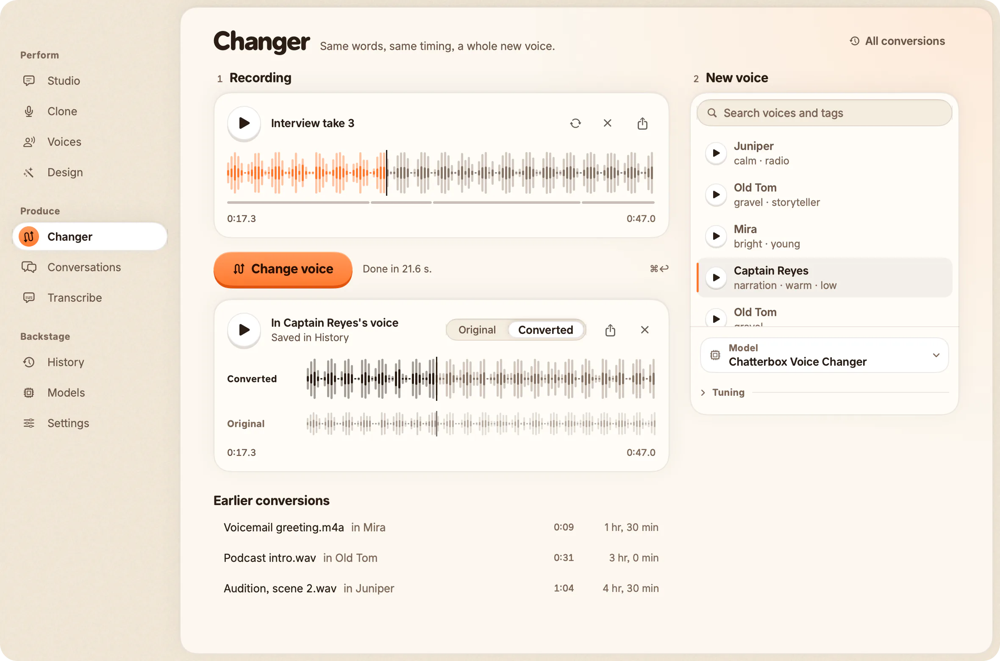
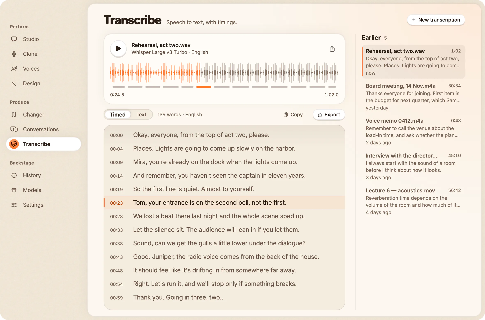
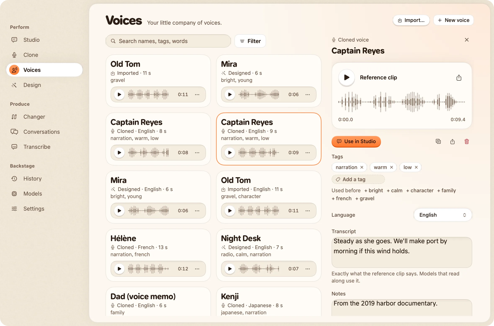
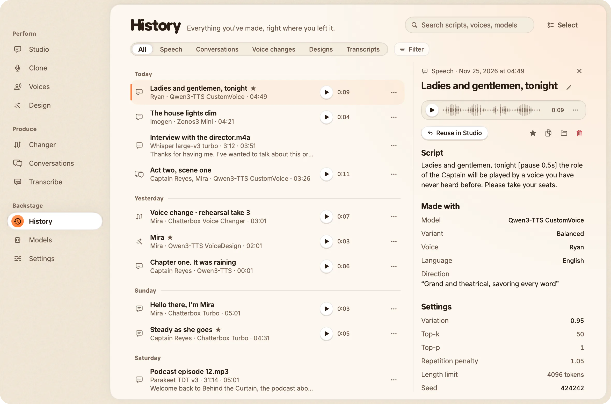
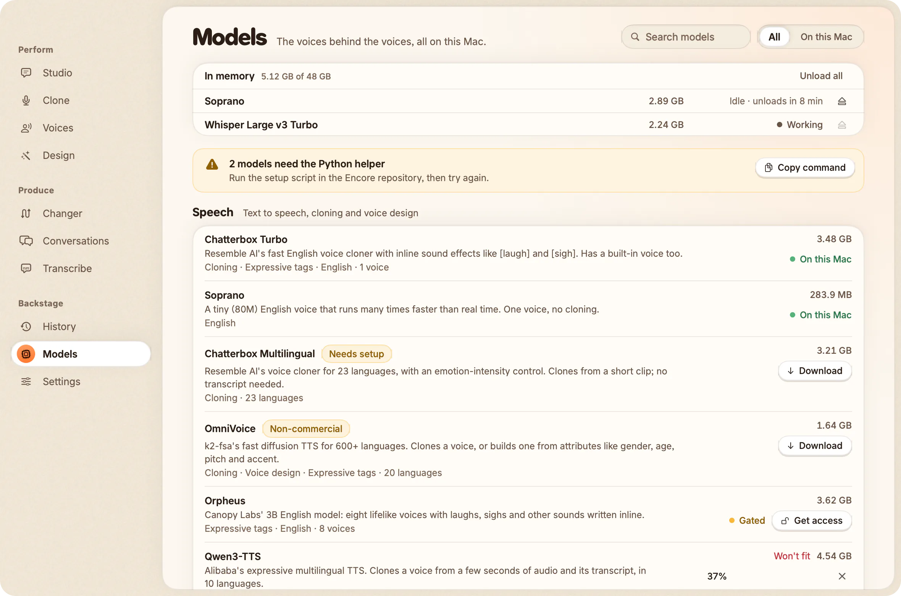

<p align="center">
  
</p>

<h1 align="center">Encore</h1>

<p align="center">
  Local voice AI for the Mac.<br>
  Text to speech, voice cloning, voice design, voice changing, multi-speaker scripts and transcription, all on your own machine.
</p>

<p align="center">
  <a href="https://encore.abdeen.dev/download"><b>Download for Mac</b></a>
  &nbsp;&middot;&nbsp;
  <a href="https://encore.abdeen.dev">Website</a>
  &nbsp;&middot;&nbsp;
  <a href="CHANGELOG.md">What's New</a>
</p>

<p align="center">
  Or with Homebrew: <code>brew install --cask abdeen-labs/tap/encore</code>
</p>

<p align="center">
  <sub>macOS 27 or later · Apple Silicon · Free and open source under the MIT license</sub>
</p>

<p align="center">
  
</p>

## What it does

<table>
  <tr>
    <td width="50%" valign="top">
      
      <h3>Clone a voice</h3>
      Drop in any recording or record a few sentences, trim it to the best 5 to 15 seconds, and save it. Encore transcribes the clip for the models that read along, and asks you to confirm the speaker's permission.
    </td>
    <td width="50%" valign="top">
      
      <h3>Design a voice</h3>
      Describe a voice in words and audition several at once. Every audition is a different voice; keep the one you like and it joins your library.
    </td>
  </tr>
  <tr>
    <td width="50%" valign="top">
      
      <h3>Perform a script</h3>
      Import a screenplay or a labeled script (<code>.txt</code>, <code>.md</code>, <code>.fountain</code>, <code>.pdf</code>), cast each speaker, and perform the whole scene. Change one line and only that line is generated again.
    </td>
    <td width="50%" valign="top">
      
      <h3>Change a voice</h3>
      Re-voice a recording in one of your voices while keeping its words, timing and delivery. Switch between the original and the result to compare.
    </td>
  </tr>
  <tr>
    <td width="50%" valign="top">
      
      <h3>Transcribe</h3>
      Turn audio or video into text with sentence or word timings. Click a line to hear it, then export plain text, SRT, WebVTT or JSON.
    </td>
    <td width="50%" valign="top">
      
      <h3>Keep a company of voices</h3>
      Cloned, designed and imported voices live in one library with tags, notes and their reference clips. Share one as an <code>.encorevoice</code> file.
    </td>
  </tr>
  <tr>
    <td width="50%" valign="top">
      
      <h3>Find every take</h3>
      Everything you make is kept with the script and settings it was made with. Search it, play it, export it, or send it back to the Studio.
    </td>
    <td width="50%" valign="top">
      
      <h3>Choose your models</h3>
      Sixteen models to download as you need them, from a 79 MB transcriber to 5 GB studio voices. Encore recommends the version that suits your Mac's memory.
    </td>
  </tr>
</table>

## It stays on your Mac

Nothing you type, record or generate leaves your computer. There is no account and no cloud. Encore goes online for two things only: Hugging Face, to download the models you pick and, if you add a token for a gated model, to check that it works; and updates.abdeen.industries, to check for a new version of Encore. It asks before checking for updates automatically, and the check sends only Encore's version.

## Writing for a voice

Scripts are plain text. A few tags shape the performance:

```text
Ladies and gentlemen, [pause 0.6s] tonight's performance begins.
[laugh] Please silence your phones.

[voice: Mira] Wait, has anyone seen the Captain?
```

| Tag | What it does |
|---|---|
| `[pause 0.8s]`, `[pause 500ms]`, `<break time="1s"/>` | A silence of that length |
| `[voice: Name]` | Switches to another voice until the next voice tag; `[voice: default]` switches back |
| `[laugh]`, `[sigh]`, `[cough]` and others | A sound, on models that have them |

A pronunciation list fixes names, jargon and acronyms for every voice. Takes can be leveled to a target loudness, have their silences tightened, and be exported as WAV, M4A or MP3.

## Models

| | Model | Best at | License |
|---|---|---|---|
| **Speech** | Soprano | Tiny and very fast; one English voice | Apache-2.0 |
| | Zonos3 Mini | 27 built-in voices in 6 languages; clones from a short clip | Apache-2.0 |
| | Chatterbox Turbo | Fast English cloning, with sounds like `[laugh]` | MIT |
| | Chatterbox Multilingual | Cloning in 23 languages, with an emotion control | MIT |
| | Qwen3-TTS | Expressive cloning in 10 languages | Apache-2.0 |
| | Qwen3-TTS CustomVoice | Nine built-in voices you direct in plain language | Apache-2.0 |
| | Qwen3-TTS VoiceDesign | A new voice from a written description | Apache-2.0 |
| | VoxCPM2 | 48 kHz output in 30 languages; clones or designs | Apache-2.0 |
| | OmniVoice | Clones, or builds a voice from attributes | CC-BY-NC-4.0, non-commercial |
| | Orpheus | Eight lifelike English voices that laugh and sigh | Apache-2.0, gated on Hugging Face |
| **Transcription** | Whisper large-v3 turbo | Fast, in 99 languages | MIT |
| | Whisper large-v3 | The most accurate Whisper | Apache-2.0 |
| | Whisper tiny | 79 MB, for quick drafts | Apache-2.0 |
| | Parakeet TDT v3 | Very fast, in 25 European languages | CC-BY-4.0 |
| | Parakeet TDT v2 | Very fast English | CC-BY-4.0 |
| **Voice changer** | Chatterbox Voice Changer | Re-voicing a recording | MIT |

Models are stored in the standard Hugging Face cache (`~/.cache/huggingface`), so other tools can share them. Each model's full license is shown in the app.

## Build it

To build Encore yourself instead of downloading it, you need an Apple Silicon Mac, macOS 27 and Xcode 27.2.

1. Install Apple's Metal Toolchain once (MLX's shaders don't compile without it):

   ```bash
   xcodebuild -downloadComponent MetalToolchain
   ```

2. Open `Encore.xcodeproj` and run the `Encore` scheme.

3. Optional, for the voice changer, word-level timestamps and Chatterbox Multilingual: set up the Python helper once. It downloads a standalone Python 3.13 and `mlx-audio` into the git-ignored `PythonHelper/.runtime` (about 680 MB):

   ```bash
   scripts/setup-python-runtime.sh
   ```

4. Optional, for MP3 export and MKV, WebM and Ogg input:

   ```bash
   brew install ffmpeg
   ```

## For developers

<details>
<summary><b>Tests, the command-line tool and screen renders</b></summary>

<br>

Run the package tests:

```bash
cd Packages/EncoreCore && swift test
```

Anything that runs MLX has to be built by Xcode, not `swift build`. The developer CLI drives the same service layer as the app:

```bash
cd Packages/EncoreCore && xcodebuild -scheme encore-cli -configuration Debug -destination 'platform=macOS,arch=arm64' -derivedDataPath ../../build/cli -skipPackagePluginValidation -skipMacroValidation build
```

```bash
build/cli/Build/Products/Debug/encore-cli service speak --model soprano --text "Hello from Encore." --out hello.wav --root /tmp/encore-test
```

Run `encore-cli` with no arguments for the other commands. `--root` keeps history and voices out of the app's real folders.

To check screens without clicking through them, build the app from the command line and have it render itself to PNGs. This loads no model and touches none of your data:

```bash
xcodebuild -project Encore.xcodeproj -scheme Encore -configuration Debug -destination 'platform=macOS,arch=arm64' -derivedDataPath build/app -skipPackagePluginValidation -skipMacroValidation build
```

```bash
build/app/Build/Products/Debug/Encore.app/Contents/MacOS/Encore --snapshot /tmp/encore-shots
```

Every screen has made-up states to render (see the `*Fixtures.swift` files), for example:

```bash
build/app/Build/Products/Debug/Encore.app/Contents/MacOS/Encore --snapshot /tmp/encore-shots --snapshot-only Studio --fixtures --studio-fixture takes --as-shipped
```

`--as-shipped` leaves out debug-only chrome. The images in this README are those renders with their corners rounded, saved as WebP in `docs/screenshots`.

</details>

<details>
<summary><b>Where things are</b></summary>

<br>

| Path | What |
|---|---|
| `Encore/` | The SwiftUI app: `App/` (shell), `Design/` (theme and components), `Features/` (one folder per screen, plus `Shared/`). |
| `Packages/EncoreCore/Sources/EncoreCore/` | Everything without UI: model catalog, service layer, Hugging Face downloads, audio, text, stores, and the Python helper bridge. |
| `Packages/EncoreCore/Sources/EncoreMLX/` | The in-process MLX Swift engines. |
| `Packages/EncoreCore/Sources/encore-cli/` | The developer CLI. |
| `PythonHelper/` | The Python worker for models with no Swift port. |
| `scripts/` | Python runtime setup, embedding it in the app, and publishing a release ([docs/RELEASING.md](docs/RELEASING.md)). |
| `docs/screenshots/` | The images in this README. |

All generation goes through `EncoreService` (`Service/EncoreService.swift`). Its request and event types are `Codable`, so a local HTTP API can wrap it directly.

The design rules (where the accent light, the serif and each decoration may appear) are at the top of `Encore/Design/Theme.swift`.

</details>

<details>
<summary><b>Add a model</b></summary>

<br>

Add a JSON manifest to `Packages/EncoreCore/Sources/EncoreCore/Resources/Manifests/`. It declares the Hugging Face repos, license, capabilities, voices, and every generation parameter; the UI is rendered from it. The manifest's `engine` key must be one a backend supports: see `MLXEngines.swift` for Swift and `PythonHelper/encore_helper/` for Python. `ManifestTests` checks it.

</details>

## Credits

Encore is built with [MLX Swift](https://github.com/ml-explore/mlx-swift), mlx-audio and its Swift port, Hugging Face's Swift libraries and [GRDB](https://github.com/groue/GRDB.swift). The voices come from the people behind Chatterbox (Resemble AI), OmniVoice (k2-fsa), Orpheus (Canopy Labs), Parakeet (NVIDIA), Qwen3-TTS (Alibaba Cloud), Soprano (Eugene Kwek), VoxCPM (OpenBMB), Whisper (OpenAI) and Zonos (Zyphra), with weights converted by the mlx-community on Hugging Face.

## License

[MIT](LICENSE). Each model has its own license: OmniVoice is for non-commercial use, and Orpheus asks you to accept its terms on Hugging Face first.
